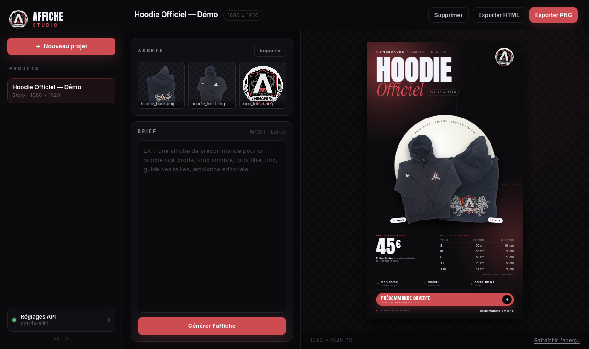

# Affiche Studio

Générateur d'affiches assisté par IA. Vous importez vos images, vous décrivez le brief, et l'application écrit une affiche **en HTML/CSS** — pas une image générée — puis l'exporte en PNG haute résolution.



## Pourquoi

Les générateurs d'images produisent des visuels impossibles à retoucher. Affiche Studio produit du code : chaque titre, chaque marge, chaque couleur reste modifiable, et le rendu final est net à n'importe quelle taille.

## Fonctionnalités (v1.0)

- Projets locaux avec formats Story, Carré, A4 et A3 (ou dimensions personnalisées)
- Import d'images, logos et polices dans le projet
- Génération en streaming depuis n'importe quelle API compatible OpenAI
- Aperçu live de l'affiche générée
- Export PNG (rendu par Chrome/Chromium/Edge) et HTML autonome
- Clé API optionnellement mémorisée (fichier de configuration en `0600`)

## Configuration API

L'application fonctionne avec tout endpoint compatible OpenAI :

| Fournisseur | Base URL | Exemple de modèle |
|---|---|---|
| OpenAI | `https://api.openai.com/v1` | `gpt-4o-mini` |
| OpenRouter | `https://openrouter.ai/api/v1` | `anthropic/claude-3.5-sonnet` |
| Groq | `https://api.groq.com/openai/v1` | `llama-3.3-70b-versatile` |
| DeepSeek | `https://api.deepseek.com/v1` | `deepseek-chat` |
| Ollama | `http://localhost:11434/v1` | `qwen2.5-coder:32b` |

Une clé peut aussi être fournie par variable d'environnement : `AFFICHE_STUDIO_API_KEY` ou `OPENAI_API_KEY`.

## Export PNG

Le rendu PNG passe par un navigateur Chromium en mode headless. Il faut donc que **Google Chrome, Chromium, Microsoft Edge ou Brave** soit installé sur la machine. L'application détecte automatiquement le navigateur ; en cas d'échec, l'export HTML reste disponible.

## Développement

Prérequis : Rust ≥ 1.77, Node ≥ 18, et les dépendances Tauri
(`libwebkit2gtk-4.1-dev`, `libgtk-3-dev`, `librsvg2-dev` sur Debian/Ubuntu).

```bash
npm install
npm run dev      # lance l'app en dev
npm run build    # bundles dans src-tauri/target/release/bundle
```

Le frontend est en HTML/CSS/JS pur, sans bundler : `dist/` est servi tel quel par Tauri.

## Distribution

Le workflow `.github/workflows/release.yml` construit, sur tag `v*` :

- **Linux** : `.deb`, `.AppImage`, `.rpm` (via Tauri)
- **Windows** : `.msi`, `.exe` (NSIS)
- **macOS** : `.dmg` et `.zip`, universel Intel + Apple Silicon
- **Flatpak** : `affiche-studio.flatpak` (job séparé, à valider au premier release)

Créer un release :

```bash
git tag v0.1.0
git push origin v0.1.0
```

> Les builds Windows et macOS se font sur les runners GitHub Actions : compiler un `.exe` ou un `.dmg` depuis Linux n'est pas fiable.

## Sécurité

- La clé API n'est jamais incluse dans les projets exportés.
- Si « Mémoriser la clé » est coché, elle est écrite dans le dossier de configuration de l'application avec des permissions `0600` (Unix). Sinon elle reste en mémoire pour la session.
- Les projets sont stockés dans le dossier de données de l'application, jamais envoyés ailleurs qu'à l'API que vous configurez.

## Licence

MIT — voir [LICENSE](LICENSE).
